<div align="center">


# ClaimFlow — 公司报销 / Claim 系统

**Less Paper. More Progress.**

拍一张收据 → 系统自动读出商家、日期、项目和金额 → 员工确认后送审 → Admin 批准或退回

Laravel 13 · PHP 8.3 · MySQL / MariaDB · Blade + Tailwind CSS 4 · 本地 OCR（Tesseract）· **不用 AI、不用云端服务**

</div>

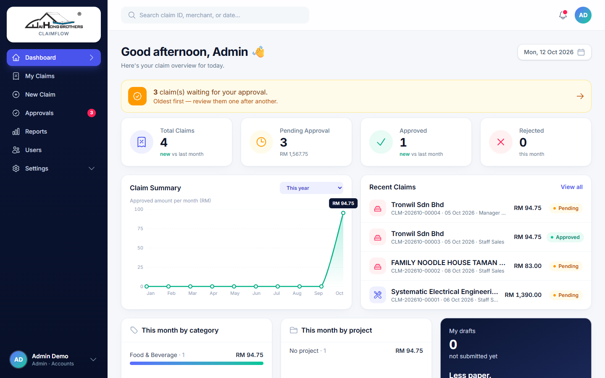

---

## 目录

1. [功能介绍](#1-功能介绍)
2. [使用方法（员工）](#2-使用方法员工)
3. [使用方法（Admin 审批）](#3-使用方法admin-审批)
4. [角色与权限](#4-角色与权限)
5. [安装（Windows + XAMPP）](#5-安装windows--xampp)
6. [本地 OCR 设置](#6-本地-ocr-设置)
7. [测试](#7-测试)
8. [备份与还原](#8-备份与还原)
9. [上线注意事项](#9-上线注意事项)
10. [已知限制](#10-已知限制)

---

## 1. 功能介绍

| 功能 | 说明 |
|---|---|
| 📷 **拍照 / 上传收据** | 手机可直接开相机拍；也支持 JPG、PNG、PDF，一张 Claim 可放多张收据 |
| 🔍 **本地 OCR 自动填写** | 自动读出商家名称、地址、日期、时间、每个项目（数量 × 单价）、加料、服务费、SST、Rounding、总额；自动填入的栏位会以**黄色**标示，方便核对 |
| 🏷️ **自动选类别** | 同一商家以前用过的类别优先；否则按关键字（例如 KFC → Food & Beverage），关键字可在 Settings 里自己加 |
| ✅ **审批流程** | 草稿 → 送审（锁定）→ 批准 / 退回（必须写原因，员工修改后可重新送审） |
| 🧮 **金额自动计算** | 后端重新计算每一行和总额；若和收据上印的总额不一样，会显示差额提醒 |
| 📊 **Dashboard** | 本月统计、和上个月比较、每月报销折线图、按类别 / 项目统计、最近的 Claim |
| 🔔 **通知** | 铃铛显示：待审批、被退回、未送出的草稿 |
| 📑 **报表 / CSV 导出** | 按日期、类别、员工、部门、项目、金额、状态筛选，并可导出 CSV |
| 🔐 **权限与审计** | 角色权限可在后台勾选；所有重要操作都记录在 Audit Log |
| 📱 **手机友好** | 手机有底部导航，所有页面都适配手机屏幕 |

---

## 2. 使用方法（员工）

### 第 1 步：登录

打开系统网址，用公司 Email 和密码登录。

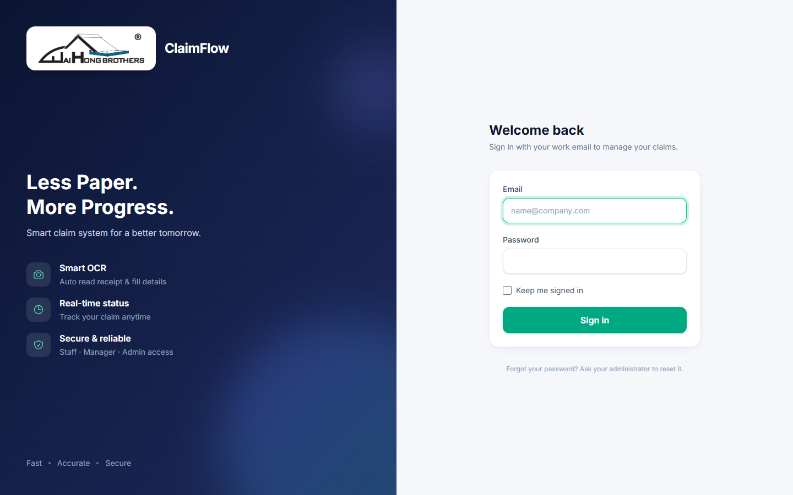

### 第 2 步：新增 Claim，上传收据

左边菜单按 **New Claim**（手机：首页的 **＋ New Claim** 按钮）。

- 手机按 **Take Photo** 直接拍；电脑按 **Choose File**，或把文件拖进框里。
- 可以一次加多张收据；没有收据就按 **Enter manually** 手动输入。
- 按 **Continue**，系统会读取收据（每张约几秒钟）。

> 💡 拍照技巧：收据摊平、光线充足、让收据占满整个画面，读得最准。

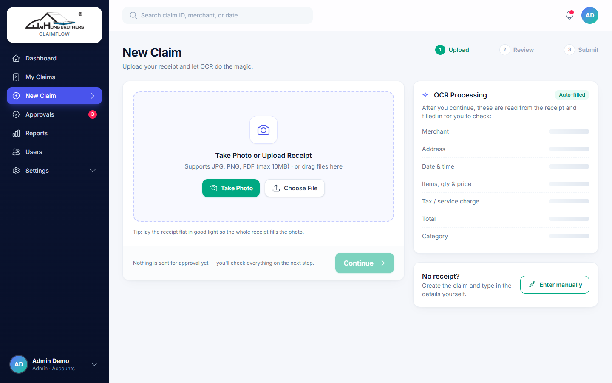

### 第 3 步：核对自动填好的资料

- 左边是收据照片，右边是系统自动填好的资料。
- **黄色栏位**是 OCR 自动填的，请对照照片检查一遍。
- 项目、数量、单价不对的话，直接修改；也可以按 **Add item** 加项目。
- 下方会显示系统算出的总额，以及和收据总额的差额（如果有）。
- 按 **Save Draft** 先存草稿，或按 **Submit for approval** 送审。

> ⚠️ 送审后 Claim 会**锁定**，审批期间不能修改。

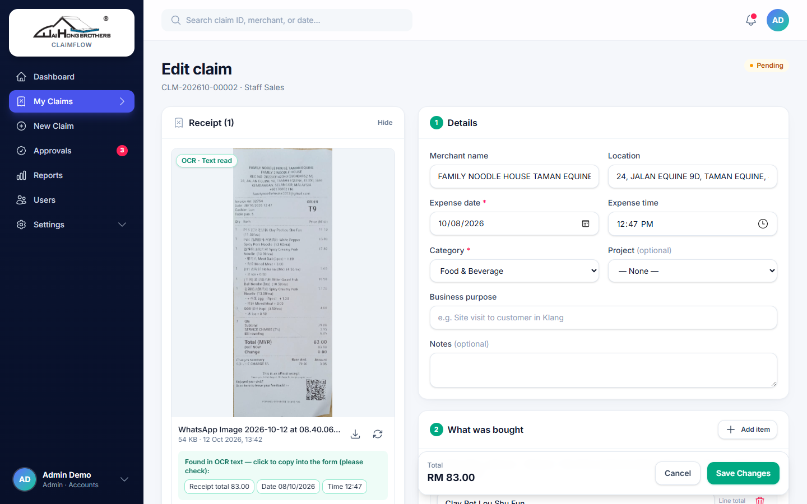

### 第 4 步：查看进度

**My Claims** 列出你所有的 Claim，可以按状态分页（All / Draft / Pending / Approved / Rejected）、搜索和筛选。

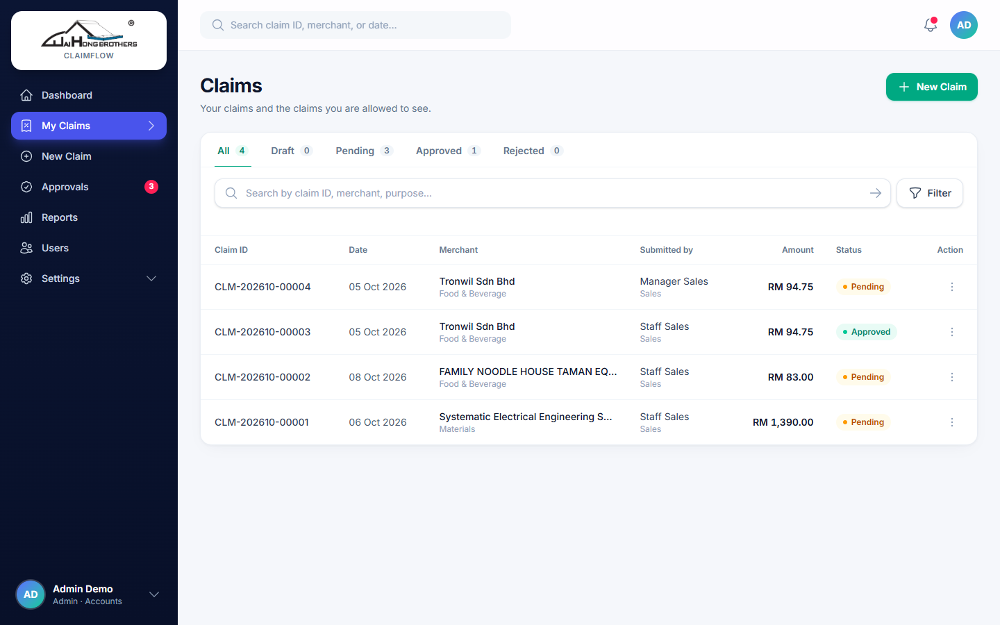

点进去可以看到收据、明细和进度（Draft → Submitted → Approved）。

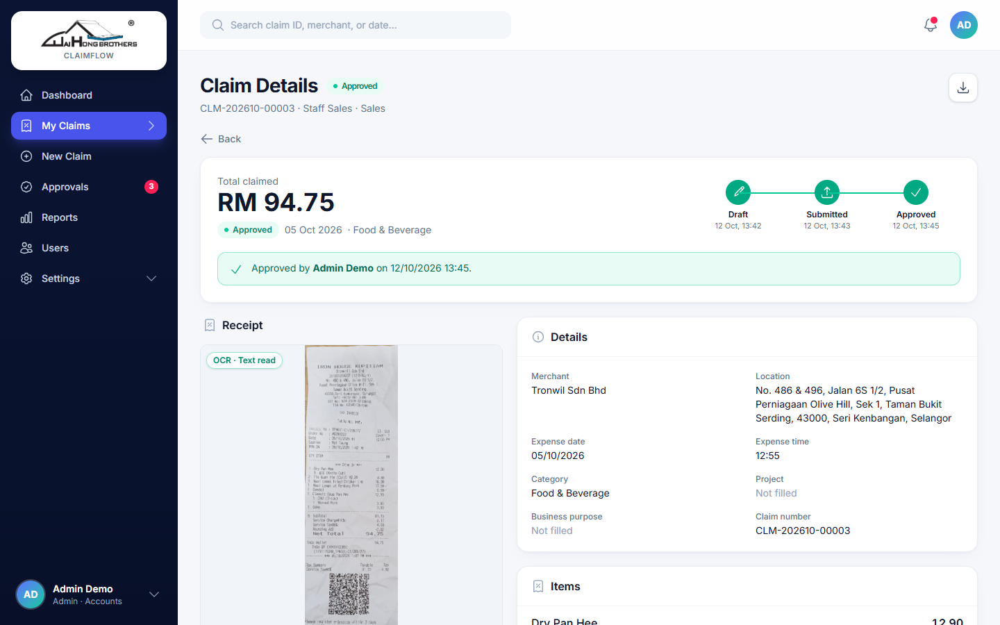

### 被退回怎么办？

Dashboard 和铃铛会显示红色提示和 Admin 写的原因。点进去修改后按 **Resubmit for approval** 重新送审即可。

---

## 3. 使用方法（Admin 审批）

1. 左边菜单 **Approvals**（红色数字 = 待审批数量）。
2. **Pending** 分页按送审时间排列，最早的在最上面；**Approved / Rejected** 分页可查看已处理的记录。

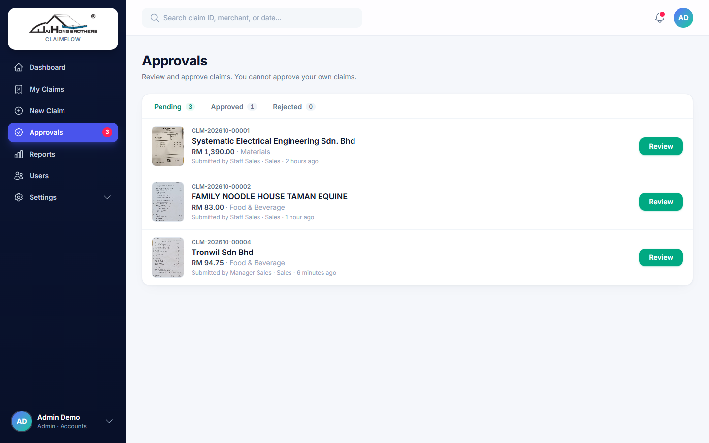

3. 按 **Review** 打开 Claim，对照收据和金额：
   - **Approve**：可选填备注；
   - **Reject**：必须填原因，员工会看到。
4. 处理完会自动跳到下一张待审批的 Claim。

> 🔒 任何人（包括 Admin）都**不能批准自己的 Claim**。已批准的 Claim 不能再修改。

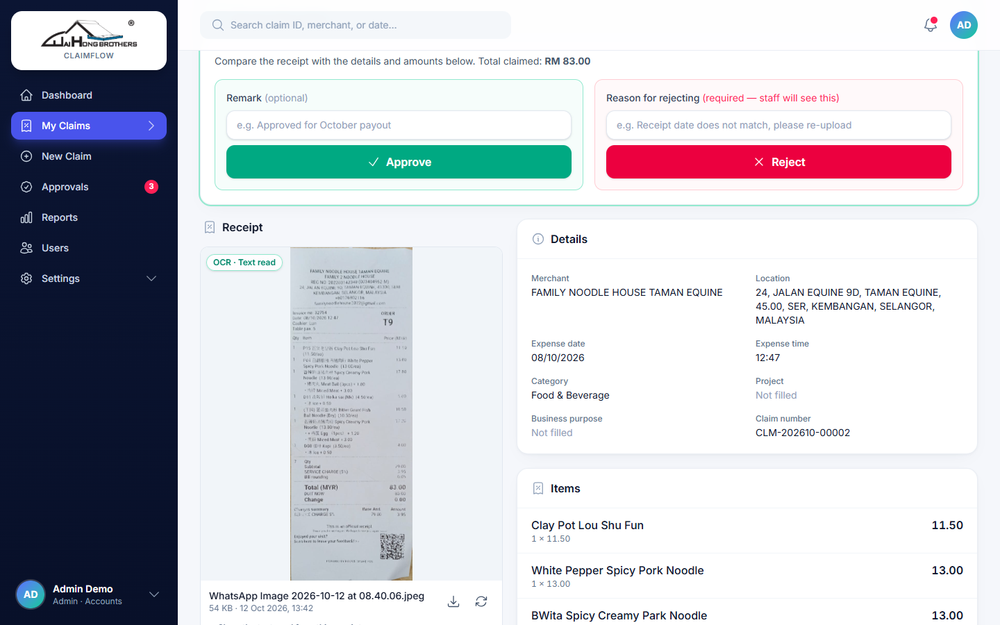

### 报表

**Reports**：按条件筛选并导出 CSV（只包含你有权限看到的资料）。

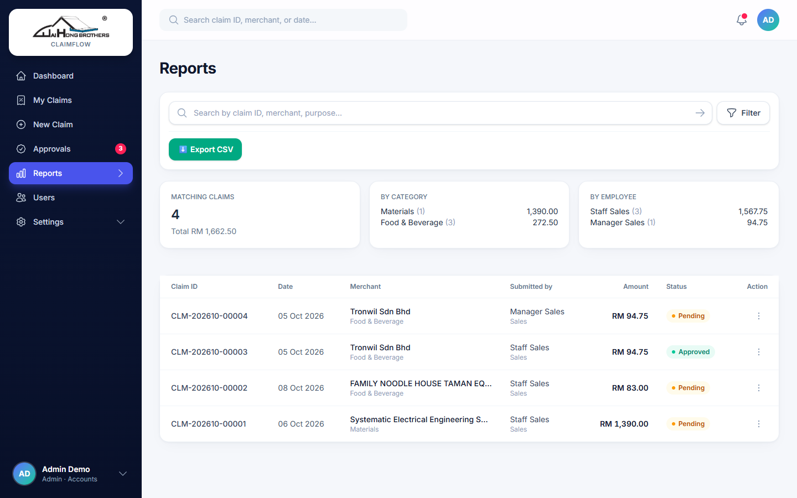

### 手机版

<p>
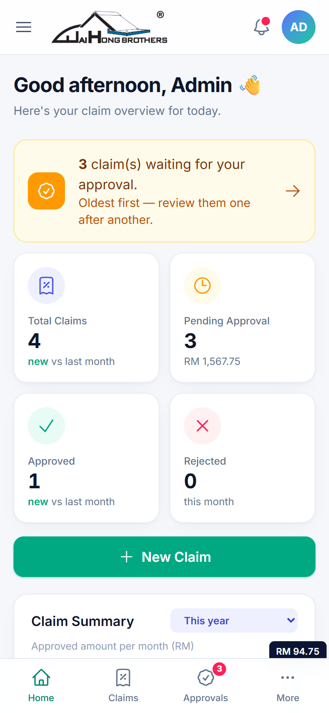
&nbsp;&nbsp;
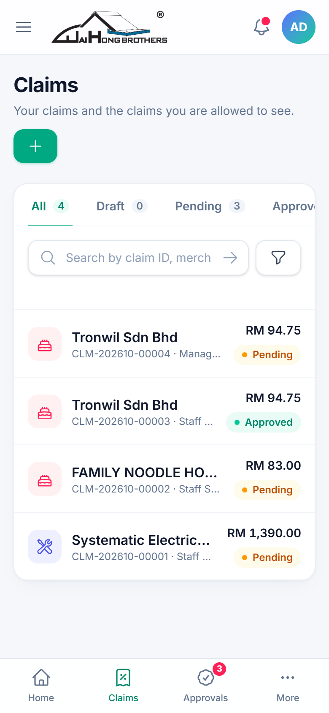
</p>

---

## 4. 角色与权限

公司规则：**每个人只能看到自己的 Claim，只有 Admin 能看到所有人的。**

| 角色 | 能看到谁的 Claim | 报表 | 审批 | 系统设置 |
|---|---|---|---|---|
| Staff | 只有自己的 | ✗ | ✗ | ✗ |
| Manager | 只有自己的 | ✗ | ✗ | ✗ |
| Owner | 只有自己的 | ✗ | ✗ | ✗ |
| **Admin** | **所有人的** | ✓ | ✓ | ✓ |

- 权限是按"权限项目"判断的，不是按角色名字。Admin 可以在 **Settings → Roles & Permissions** 给某个角色多勾权限，例如让 Owner 看全部（`claims.view_all`）、让 Manager 看同部门（`claims.view_department`），不用改程序。
- 权限检查在后端执行：直接改网址里的 Claim 编号或收据编号，一样会被拒绝（403）。

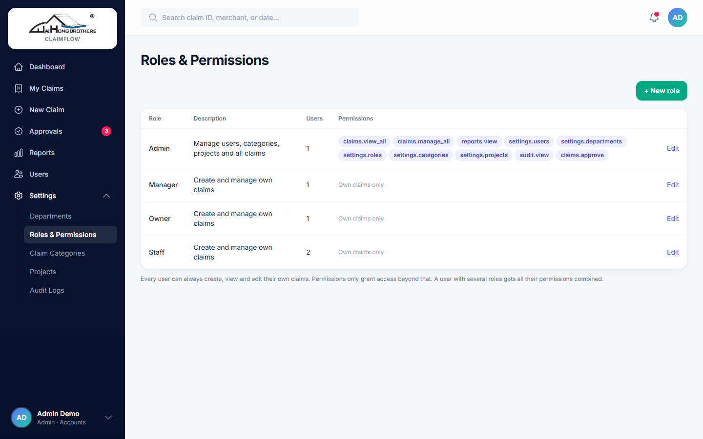

### 金额规则

- `每行金额 = 数量 × 单价 − 折扣 + 税`；收据只有总额时，单价留空、直接填 **Amount**。
- Claim 总额 = 所有行加总。以"分"为单位计算，避免小数误差。
- 系统分开保存三个数字：OCR 读到的总额（只当提示）、员工确认的**收据总额**、系统算出的**Claim 总额**。三者不一致时会显示差额，不会互相覆盖。
- 设定为"需要收据"的类别，没有收据就不能送审（草稿可以）。

---

## 5. 安装（Windows + XAMPP）

**需求：** PHP ≥ 8.3（扩展：pdo_mysql、mbstring、fileinfo、gd、openssl、zip；跑测试需 pdo_sqlite）、Composer、Node.js ≥ 20、MySQL / MariaDB。

```powershell
cd C:\xampp\htdocs
git clone https://github.com/Roderick1218/Claim-System.git claim-system
cd claim-system
composer install
copy .env.example .env
php artisan key:generate
# 编辑 .env：DB_*、APP_URL、TESSERACT_PATH、PDFTOTEXT_PATH / PDFTOPPM_PATH
```

建立资料库（phpMyAdmin 或以下 SQL）：

```sql
CREATE DATABASE claim_system CHARACTER SET utf8mb4 COLLATE utf8mb4_unicode_ci;
```

```powershell
php artisan migrate
php artisan db:seed --class=RolePermissionSeeder
php artisan db:seed --class=ClaimCategorySeeder
# 只在本地测试时用（建立示范账号，密码 password123）：
php artisan db:seed --class=DemoDataSeeder
npm install
npm run build
```

打开 `http://localhost/claim-system/public`，或执行 `php artisan serve` 后打开 `http://127.0.0.1:8000`。

### 示范账号（DemoDataSeeder — 上线前请删除或停用）

| Email | 角色 | 部门 |
|---|---|---|
| admin@claim.local | admin | Accounts |
| owner@claim.local | owner | Management |
| manager@claim.local | manager | Sales |
| staff@claim.local | staff | Sales |
| staff2@claim.local | staff | Operations |

所有账号密码：`password123`

### 正式环境建立第一个 Admin（不用示范资料）

```powershell
php artisan tinker
```

```php
$u = App\Models\User::create(['name' => 'Admin', 'email' => 'admin@company.com', 'password' => 'CHANGE-ME-123']);
$u->roles()->attach(App\Models\Role::where('name', 'admin')->first());
```

### 更换 Logo

把新 Logo 存成 `public/images/logo.png`（建议透明背景 PNG）即可。系统名称在 `.env` 的 `APP_NAME` 修改。

---

## 6. 本地 OCR 设置

### Tesseract（必装）

```powershell
winget install --id UB-Mannheim.TesseractOCR -e
tesseract --version
tesseract --list-langs
```

在 `.env` 填**完整路径**，并用**单引号**：

```
TESSERACT_PATH='C:\Program Files\Tesseract-OCR\tesseract.exe'
TESSERACT_LANG=eng
TESSERACT_PSM=4,6
```

- `TESSERACT_PSM=4,6`：每张收据用两种版面模式读取，系统自动挑最好的结果（项目加起来等于总额的优先）。
- 马来文 / 中文收据：从 https://github.com/tesseract-ocr/tessdata 下载 `msa.traineddata` / `chi_sim.traineddata` 放进 `tessdata` 文件夹，再设定例如 `TESSERACT_LANG=eng+msa`。请用真实收据测试，语言越多英文可能越不准。

> 如果 Apache 以 Windows 服务（其他账户）执行，per-user 安装路径可能读不到，请把 Tesseract 装到 `C:\Program Files`。

### Poppler（PDF 收据，选装）

```powershell
winget install --id oschwartz10612.Poppler -e
```

在 `.env` 设定 `PDFTOTEXT_PATH` 和 `PDFTOPPM_PATH`（`...\poppler-xx\Library\bin\` 里的 exe）。没装 Poppler 时 PDF 仍可上传和预览，只是不会自动读取。

---

## 7. 测试

```powershell
php artisan test
```

测试使用内存 SQLite 和假的 OCR 引擎，不会动到真实资料库，也不会呼叫 Tesseract。涵盖：登录 / 停用账号、权限范围（改 ID 偷看）、审批流程、金额计算、收据上传检查、OCR 失败与重试、OCR 文字解析（各种真实收据格式）、报表筛选、CSV 导出安全等。

---

## 8. 备份与还原

资料库和收据文件**两个都要备份**，缺一不可。

| 内容 | 位置 |
|---|---|
| 资料库 | `claim_system` |
| 收据文件 | `storage/app/private/receipts/` |
| 设定 | `.env`（含密码，请另外安全保存，不要放进 Git） |

```powershell
# 备份（XAMPP MariaDB，端口按你的设定）
$d = Get-Date -Format yyyyMMdd-HHmm
New-Item -ItemType Directory -Force D:\backup\claim\$d
cmd /c "C:\xampp\mysql\bin\mysqldump.exe --user=root --port=3306 --host=127.0.0.1 --single-transaction claim_system > D:\backup\claim\$d\claim_system.sql"
Compress-Archive C:\xampp\htdocs\claim-system\storage\app\private\receipts D:\backup\claim\$d\receipts.zip
```

```powershell
# 还原
cmd /c "C:\xampp\mysql\bin\mysql.exe --user=root --port=3306 --host=127.0.0.1 claim_system < D:\backup\claim\<日期>\claim_system.sql"
Expand-Archive D:\backup\claim\<日期>\receipts.zip C:\xampp\htdocs\claim-system\storage\app\private\ -Force
php artisan migrate
```

建议用 Windows 工作排程器每天自动备份，并复制到其他地方（NAS / 云端硬盘）。

---

## 9. 上线注意事项

- `.env`：`APP_ENV=production`、`APP_DEBUG=false`、正确的 `APP_URL`、高强度资料库密码。
- 网站根目录指向 `public/`，不要公开整个项目文件夹。
- 收据存在 `storage/app/private`（不在 `public/` 下），只能经过权限检查后查看；**不要**为收据执行 `php artisan storage:link`。
- `storage/` 和 `bootstrap/cache/` 需可写入。
- 每次部署后执行：`php artisan config:cache && php artisan route:cache && php artisan view:cache`。
- 在办公室网络以外使用时请开 HTTPS（手机相机上传也需要 HTTPS）。
- 员工离职请"停用"账号，不要删除，旧 Claim 才会保留。
- PHP 的 `upload_max_filesize` / `post_max_size` 要大于收据大小上限 × 每次上传张数。

---

## 10. 已知限制

- OCR 准确度取决于照片品质；手写收据 Tesseract 读不出来，需要手动输入。
- 目前只有一层审批（Admin），没有 Email 通知（系统内有铃铛和 Dashboard 提示）。
- OCR 在上传时同步执行（每张几秒）；量大时可改成 Queue 背景处理。
